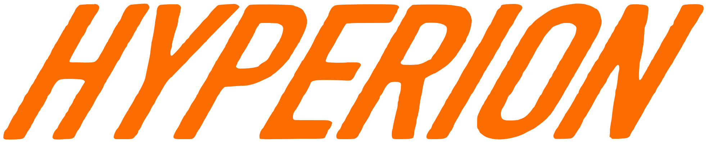
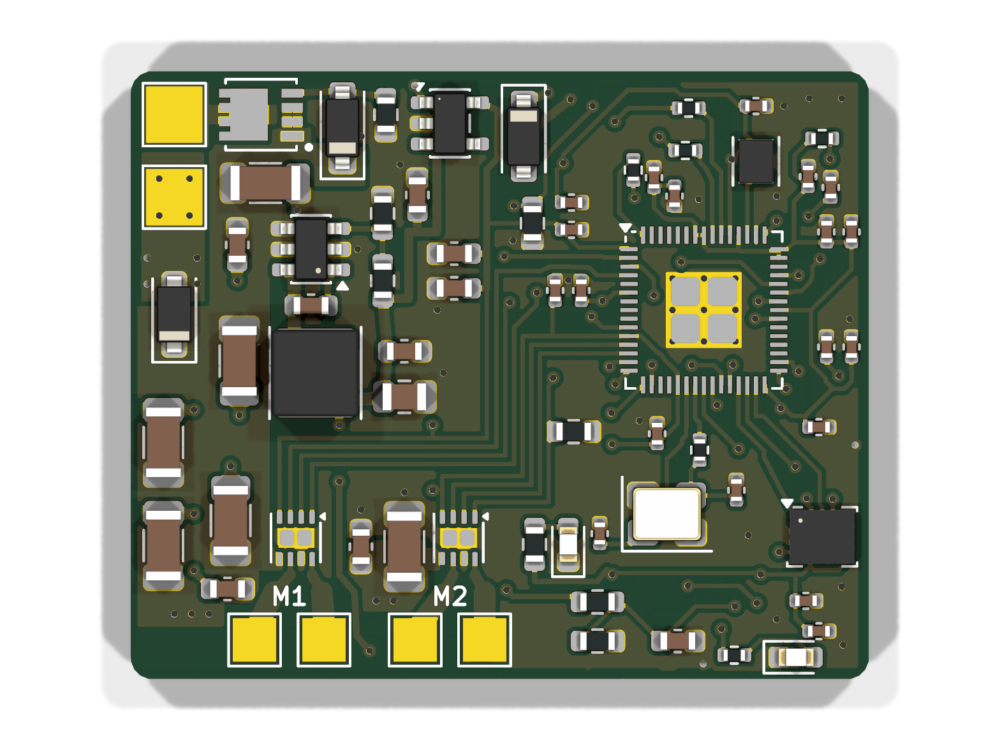
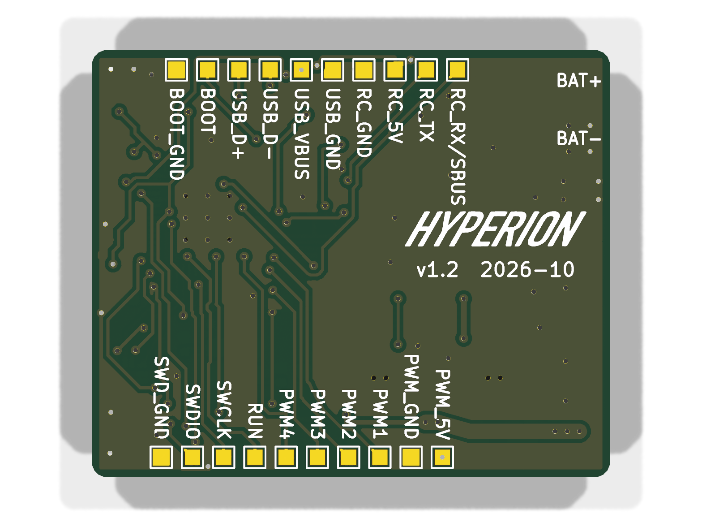

<p align="center"></p>

# Hyperion: antweight combat robot controller

Open-source all-in-one controller for 150 g antweight combat robots. It combines an RC receiver
input, two brushed drive motor drivers, power handling and an IMU on a 34 × 28 mm 2-layer board.

Designed by Team Hyperion (Faculty of Electrical Engineering and Communication, Brno University of
Technology) for the Czech Combat Robot League (Česká liga bojových robotů, FLS Battlebots).

| Top | Bottom |
|---|---|
|  |  |

## Status

**Revision v1.2: unbuilt prototype; ordering is on hold.** The recovered 2026-11-13 Konnect review
reported no DRC, connectivity or schematic-parity violations and one understood ERC warning on
the IMU's unused SDx pin. Assembly process, sourcing and the remaining checks in the
[pre-order review](docs/v1.2-preorder-review-2026-11-13.md) still need resolution. Prototype build
and physical bring-up have not happened.

## Features

- **MCU:** RP2354A (RP2350 with 2 MB internal flash), 12 MHz crystal
- **Drive:** 2× TI DRV8231A brushed H-bridge, 4.5–33 V, current limit about 1.5 A per channel
  (IPROPI current regulation). Current feedback goes to the ADC for telemetry.
- **Input power:** 2–4S LiPo
  - reverse-polarity protection (AON7403 P-FET)
  - SMF18A TVS
  - battery voltage sensing
- **Rails:**
  - 5 V buck (LMR51610) for the receiver and servo/ESC signal header
  - 3.3 V LDO (ME6211)
- **Receiver input:** universal UART/RC pads for ELRS/CRSF, SBUS, iBUS and PPM, with a 5 V supply
  for the receiver
- **Outputs:** 4 PWM pads (weapon ESC, servo, spare), each with a 5 V/GND pad
- **IMU:** LSM6DSV32X (±32 g) for auto-invert and heading hold
- **Programming:** USB pads (UF2 bootloader, BOOT pad) and SWD pads
- **Status LEDs:** red and green
- **Board:** 34 × 28 mm, 2 layers, 1.6 mm FR-4. Battery and motor pads sit on the board edge.

## Motor target

- **Drive target:** 1–2 N10/N20 gearmotors per side on a 2–4S supply, with about 1.5 A regulated
  per channel (1.47 A nominal, set by R_IPROPI = 1.5 kΩ with VREF on 3.3 V). Motors sharing a
  channel share that limit. Choose motors rated for the applied voltage; this is not a claim
  that every N10/N20 is suitable for direct 4S operation.
- **Thermal limit:** 1.47 A is a current-regulation setting, not a measured continuous rating.
  Sustained pushing and stall tests on 2S, 3S and 4S remain open. Do not increase the limit to
  compensate for a motor that stalls above it.
- **Compared with the Malenki Nano HV** (1 A continuous / 3 A peak on 3 channels, AFHDS 2A
  receiver only, no BEC): Hyperion targets the same small-motor class and adds a 5 V BEC, an IMU,
  current/battery sensing and external receiver inputs. Its continuous rating still needs
  measurement, and its nominal regulated limit is 1.47 A rather than a specified 3 A burst.
  Firmware currently supports SBUS, CRSF and two-channel PWM; transmitter telemetry, iBUS and
  PPM are planned.
- **Not for beetleweight drive.** Beetleweight drive motors need 5–12 A per channel. Hyperion can
  still be the brain of such a robot, driving external ESCs from its PWM pads.

## Repository layout

```
hardware/   KiCad 10 project (schematic, PCB, project symbol and footprint libraries)
fab/        Manufacturing files for v1.2: Gerbers + drill (zip), BOM, pick-and-place, DRC report
docs/       Schematic PDF
firmware/   Firmware (Raspberry Pi Pico SDK, C) and the bring-up plan
images/     Renders and logo
```

## Building

- **PCB:** upload `fab/hyperion-v1.2-gerbers.zip`. 2 layers, 1.6 mm. Smallest features: 0.2 mm
  track/space and 0.3 mm drill. The RP2354A's 0.4 mm-pitch QFN needs a stencil.
- **Assembly:** `fab/hyperion-v1.2-bom.csv` lists LCSC and manufacturer part numbers.
  `fab/hyperion-v1.2-pos.csv` has the pick-and-place data. C3, the 100 µF bulk capacitor, is not
  placed; it is hand-wired to its pads. The TPx test pads are bare pads with no part.
- **PCBWay:** `fab/pcbway/` holds the candidate package: Gerbers, a BOM and centroid file with only
  the assembled parts, and `ASSEMBLY_NOTES.md` (board specs, DNP list, polarity notes, sourcing).
  Resolve the [pre-order review](docs/v1.2-preorder-review-2026-11-13.md) before releasing it.
- **Opening the design:** requires KiCad 10. The custom symbols and footprints are in
  `hardware/hyperion.kicad_sym` and `hardware/hyperion.pretty`.
- **Source of truth:** develop in [hyperion-controller](https://github.com/adamhrnciar/hyperion-controller).
  The `hyperion-controller/` subtree in `antweight-analysis` is a mirror. Its older
  `antweight/pcb/hyperion/` directory is historical; do not generate new manufacturing files from it.

## Firmware

`firmware/` holds the first firmware, written in C with the Raspberry Pi Pico SDK. It builds, but
has not run on a board yet. [firmware/README.md](firmware/README.md) covers building, settings,
stick and motor conventions, and the safety behaviour. [firmware/BRINGUP.md](firmware/BRINGUP.md)
is the test plan for the first boards.

Done:
- SBUS, CRSF and PWM receiver input with failsafe. On signal loss the drive motors brake and the
  weapon ESC gets no pulses.
- Arming interlock: the robot only arms with the drive stick centred and the weapon stick down.
  A dropout shorter than 1 s during a match resumes driving at once.
- tank mixing, DRV8231A drive, weapon ESC output on PWM1
- IMU, battery voltage and motor current readout
- bring-up test modes, including a stall test for the drivers' thermal shutdown

Planned:
- iBUS and PPM input
- IMU auto-invert and heading hold
- current and battery telemetry to the transmitter

## Buying a board

Assembled and tested boards will be sold once v1.2 has passed testing. Buying one supports
further development. You are also free to build your own from the files here.

## License

The hardware is licensed under [CERN-OHL-S-2.0](LICENSE). You may make, modify and sell the board,
as long as you publish the source of any modified version under the same licence.

The firmware in `firmware/` is licensed under [GPL-3.0-or-later](firmware/LICENSE). You may use,
modify and sell it, as long as you publish the source of any modified version you distribute under
the same licence. `firmware/pico_sdk_import.cmake` is BSD-3-Clause (Raspberry Pi Ltd).

The licence does not cover the name "Hyperion" or the Hyperion logo. Modified or third-party boards
must not be sold under that name or with that logo.
