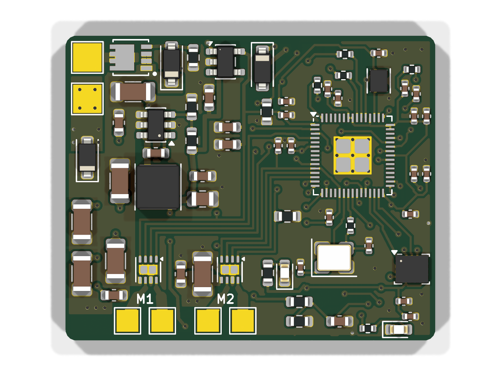
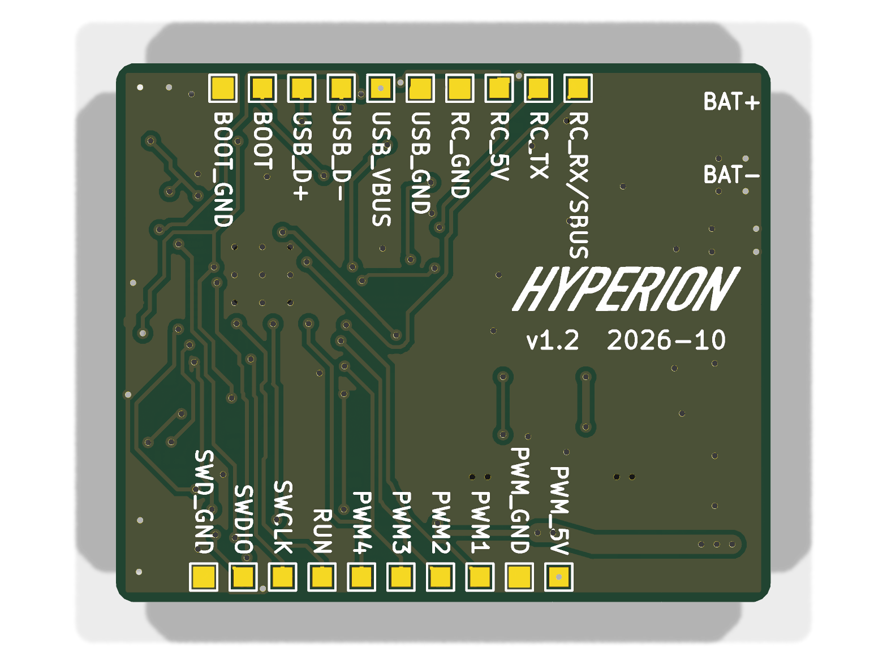

<p align="center"></p>

# Hyperion: antweight combat robot controller

Open-source all-in-one controller for 150 g antweight combat robots. It combines an RC receiver
input, two brushed drive motor drivers, power handling and an IMU on a 34 × 28 mm 2-layer board.

Designed by Team Hyperion (Faculty of Electrical Engineering and Communication, Brno University of
Technology) for the Czech Combat Robot League (Česká liga bojových robotů, FLS Battlebots).

| Top | Bottom |
|---|---|
|  |  |

## Status

**Revision v1.2: design complete, not yet built.** Schematic ERC and PCB DRC are clean. All main
parts were checked against their datasheets. Prototype build and bring-up are next. Treat this
revision as untested until this section says otherwise.

## Features

- **MCU:** RP2354A (RP2350 with 2 MB internal flash), 12 MHz crystal
- **Drive:** 2× TI DRV8231A brushed H-bridge, 4.5–33 V, current limit about 2 A per channel
  (IPROPI current regulation). Current feedback goes to the ADC for telemetry.
- **Input power:** 2–4S LiPo
  - reverse-polarity protection (AON7403 P-FET)
  - SMF18A TVS
  - battery voltage sensing
- **Rails:**
  - 5 V buck (LMR51610) for the receiver and servo/ESC signal header
  - 3.3 V LDO (ME6211)
- **Receiver input:** universal UART/RC pads for ELRS/CRSF, SBUS, iBUS and PPM, with a 5 V supply
  for the receiver
- **Outputs:** 4 PWM pads (weapon ESC, servo, spare), each with a 5 V/GND pad
- **IMU:** LSM6DSV32X (±32 g) for auto-invert and heading hold
- **Programming:** USB pads (UF2 bootloader, BOOT pad) and SWD pads
- **Status LEDs:** red and green
- **Board:** 34 × 28 mm, 2 layers, 1.6 mm FR-4. Battery and motor pads sit on the board edge.

## Repository layout

```
hardware/   KiCad 10 project (schematic, PCB, project symbol and footprint libraries)
fab/        Manufacturing files for v1.2: Gerbers + drill (zip), BOM, pick-and-place, DRC report
docs/       Schematic PDF
images/     Renders and logo
```

## Building

- **PCB:** upload `fab/hyperion-v1.2-gerbers.zip`. 2 layers, 1.6 mm. Smallest features: 0.2 mm
  track/space and 0.3 mm drill. The RP2354A's 0.4 mm-pitch QFN needs a stencil.
- **Assembly:** `fab/hyperion-v1.2-bom.csv` lists LCSC and manufacturer part numbers.
  `fab/hyperion-v1.2-pos.csv` has the pick-and-place data. Parts marked DNP in the BOM are
  optional; for example, the 100 µF bulk capacitor is hand-wired to pads.
- **Opening the design:** requires KiCad 10. The custom symbols and footprints are in
  `hardware/hyperion.kicad_sym` and `hardware/hyperion.pretty`.

## Firmware

Not published yet. The planned features are:
- CRSF/SBUS/iBUS/PPM input with failsafe
- tank mixing
- IMU auto-invert and heading hold
- current and battery telemetry

## Buying a board

Assembled and tested boards will be sold once v1.2 has passed testing. Buying one supports
further development. You are also free to build your own from the files here.

## License

The hardware is licensed under [CERN-OHL-S-2.0](LICENSE). You may make, modify and sell the board,
as long as you publish the source of any modified version under the same licence.

The licence does not cover the name "Hyperion" or the Hyperion logo. Modified or third-party boards
must not be sold under that name or with that logo.
